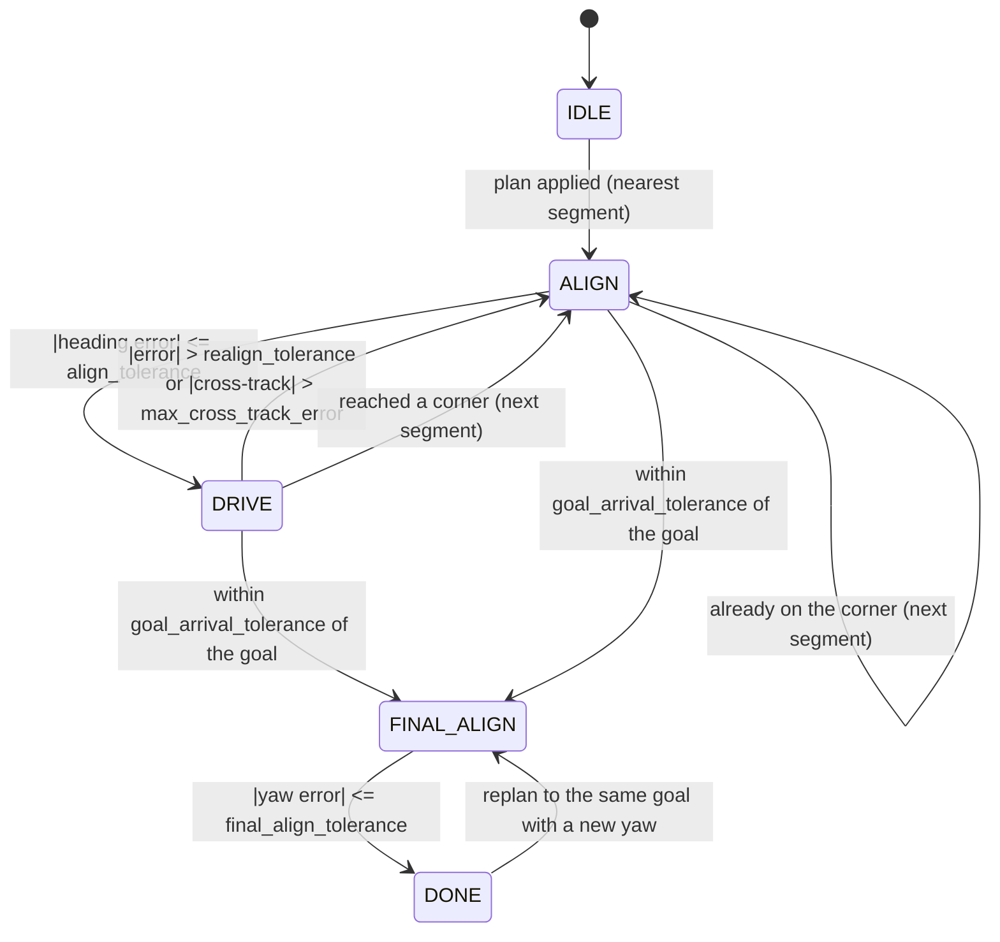

# point_and_turn_controller

A Nav2 `nav2_core::Controller` plugin that follows a path the way a skid-steer
digging robot is easiest to predict: rotate in place to face the next corner,
then drive straight to it. It never commands linear and angular velocity in
the same cycle unless `drive_heading_gain` is set above zero.

```bash
colcon build --symlink-install --packages-select point_and_turn_controller
colcon test --packages-select point_and_turn_controller
```

The robot uses it through `robot_navigation` with `controller:=pnt`; the
parameters live in `robot_navigation/config/controller_pnt.yaml`.

## State machine



| State | Linear | Angular |
| --- | --- | --- |
| ALIGN | 0 | `angular_gain * err`, magnitude clamped to [`min_angular_speed`, `max_angular_speed`] |
| DRIVE | `min(v_max * scale, sqrt(2 * decel * remaining))`, floored at `min_linear_speed` | 0 (or a capped correction, see below) |
| FINAL_ALIGN | 0 | as ALIGN, toward the goal yaw |
| IDLE, DONE | 0 | 0 |

A transition runs the new state in the same cycle, so the robot doesn't get a
zero command between states.

## Code layout

| File | Contents |
| --- | --- |
| `include/.../core.hpp`, `src/core.cpp` | ROS-free core: path simplifier and state machine. Plain C++17, built as a static PIC library. |
| `include/.../point_and_turn_controller.hpp`, `src/point_and_turn_controller.cpp` | The plugin: parameters, TF, costmap collision checks, debug topics. |
| `test/test_simplifier.cpp`, `test/test_core.cpp` | gtest against the core only, including closed-loop runs at 20 Hz. |

Keeping ROS out of the core means its tests need no ROS graph, no costmap and
no TF; they run in milliseconds and under ASan/UBSan. The wrapper is thin
enough to check by reading and in simulation.

## Design decisions

| Decision | Why |
| --- | --- |
| Simplify the path to corners before following it | Planners emit a pose every ~5 cm. Aligning to each next pose would pivot every 5 cm. |
| Reumann-Witkam corridor pass, O(n) | One forward pass with a constant amount of work per point. Douglas-Peucker is O(n log n) on average and O(n²) worst case, and it needs the whole path in recursion. |
| Corridor direction from the first point >= `min_segment_length` from the anchor | Points right next to the anchor give a meaningless direction. |
| Vertex = point of maximum progress along the corridor | A Reeds-Shepp cusp reverses along the same line and never leaves the corridor sideways; "last point inside the tolerance" would cut it short. The same rule puts a right-angle corner exactly on the corner instead of up to 5 cm along the next leg, where it would trip the bearing check just before arrival. |
| Merge a corner within `min_segment_length` of the goal | A pivot for 5 cm of travel is all cost. The first point is never merged away. |
| ALIGN aims at the bearing to the corner, not the segment heading | After slip, the segment heading points along a line parallel to the path, so the robot would never reach it. The bearing always closes the gap. Within `min_bearing_distance` of an intermediate corner the bearing swings wildly, so it falls back to the segment heading. |
| Hysteresis: leave ALIGN at 0.05 rad, return at 0.20 rad | With a single threshold, sensor noise around it would flip ALIGN and DRIVE every cycle. `configure` rejects `align_tolerance >= realign_tolerance`. |
| Cross-track measured from where DRIVE started | Re-anchored on each entry, it measures drift since the robot last aimed, which is what a re-aim can fix. |
| Skip the checks within `min_bearing_distance` of the corner | Near the corner small position errors make large bearing errors, which would trigger pointless re-aims just before arrival. |
| Brake as `sqrt(2 * decel * remaining)` | The fastest speed from which the robot can still stop at the corner. It also keeps the stopping distance, and so the collision look-ahead, inside the segment. |
| Speed floor never exceeds a speed limit | `min_linear_speed` keeps the last centimetres from crawling, but a speed-limit zone below it wins. |
| Rotation floor `min_angular_speed` | Real drivetrains stall at low turn rates. It's safe because one cycle at the floor (0.15 rad/s × 50 ms = 0.0075 rad) stays well inside `align_tolerance`. |
| Arrival tolerances below the goal checker | 0.05 m at corners, 0.10 m / 0.10 rad at the goal, all inside the shared goal checker's 0.20 m / 0.20 rad, so the controller never stops where the checker still says no. |
| Replan: keep state when the target survives | The behavior tree replans about once a second. Restarting each time would re-align every second. A new plan keeps the state if it has a vertex within `replan_match_tolerance` of the current target, or, at the goal, the same goal. |
| Otherwise start at the nearest segment, ties to the earliest | At a cusp the outbound and return legs overlap; the robot has not done the return leg yet. |
| Plan applied on the next cycle, not in `setPlan` | `setPlan` has no robot pose, and matching and nearest-segment selection need one. |
| Reversing decided once per segment | The smaller rotation wins: forward or backward along the segment. Deciding every cycle would flip direction on noise near ±90°. Smac Hybrid-A* plans reverse segments, so the robot config turns it on. |
| State machine in the plan frame, collision checks in the costmap frame | Transforming one robot pose per cycle is O(1). Transforming the plan would be O(n) per cycle. Collision checks use the pose Nav2 passes in, which is already in the costmap frame. |
| Sweep the whole rotation before pivoting | The task asks for a forward check only, but the 1.72 × 0.80 m footprint sweeps a circle of about 0.95 m radius. Its corners hit things nowhere near the front. |
| Stopping distance from max(commanded, measured) speed | The robot may still be carrying speed the controller no longer commands. |
| Yaw straight from the quaternion | One `atan2` instead of pulling in `tf2_geometry_msgs` for a conversion. |
| Debug topics are transient-local | A late `ros2 topic echo` or RViz sees the current state and vertices immediately. |

### Heading correction (`drive_heading_gain`)

The default 0 keeps DRIVE purely linear, as the spec requires. Slip then
shows up as cross-track or bearing error, and the robot stops and re-aims.
With a gain above zero, DRIVE adds `clamp(gain * err, ±max_drive_angular_speed)`
while far enough from the corner. The robot drifts less and pivots less often,
but it no longer moves in pure segments: some cycles command linear and angular
motion together. `test_core` measures both sides of this trade-off.

## Topics

| Topic | Type | Published |
| --- | --- | --- |
| `<plugin>/state` (`/FollowPath/state`) | `std_msgs/String` | On change |
| `<plugin>/vertices` (`/FollowPath/vertices`) | `nav_msgs/Path` | Whenever a plan is applied, in the plan frame |

## Failures

| Condition | Exception | Controller server response |
| --- | --- | --- |
| No plan, or an empty one | `nav2_core::InvalidPath` | Aborts FollowPath |
| Robot pose can't be transformed into the plan frame | `nav2_core::ControllerTFError` | Aborts FollowPath |
| A lethal cell (or unknown, if `allow_unknown` is false) within the stopping distance in DRIVE, or in the footprint's rotation sweep in ALIGN / FINAL_ALIGN | `nav2_core::NoValidControl` | Publishes zero and retries for `failure_tolerance`, then aborts so the behavior tree can recover |

## Per-cycle cost

n = plan poses, k = vertices (k ≪ n), P = footprint outline cells
(about 2 × (1.72 + 0.80) / 0.05 ≈ 100 at 5 cm resolution).

| Work | Cost |
| --- | --- |
| `setPlan` | O(n) copy |
| Applying a new plan (first cycle after `setPlan`) | O(n) simplify + O(k) match or nearest segment |
| Every other cycle: state machine | O(1) |
| TF | One pose transform |
| DRIVE collision check | ⌈reach / resolution⌉ × P. At 0.40 m/s, reach = 0.20 + 0.15 m, so 7 samples, about 700 cell reads |
| ALIGN collision check | ⌈rotation / step⌉ × P. A half turn at 0.05 rad is 63 samples, about 6 300 cell reads |

## Known limitations

- **Corridor direction is set by one point.** A probe point off the line by
  e tilts the whole corridor by about e / `min_segment_length`. The corridor
  then leaves the path after roughly `corridor_tolerance` divided by that tilt:
  about 1.7 m for 3 mm of point-to-point jitter. Smooth planner output is
  fine. Jittery paths get extra vertices; each costs a slowdown, plus a pivot
  if it bends more than `align_tolerance`.
- **Rotation sweep sampling.** At step s, the footprint's far corner (0.95 m
  out) moves 0.95 × s between samples. Keep s at or below resolution / 0.95
  (≈ 0.05 rad at 5 cm) so a one-cell obstacle can't fall between samples. The
  plugin default is 0.1 rad; the robot config sets 0.05.
- **Outline-only footprint cost.** `FootprintCollisionChecker` reads the
  footprint outline. Samples one cell apart sweep the outline across every
  cell, and the voxel layer clears the cells under the robot itself, so this
  is enough here.
- **The progress checker counts only position.** A long pivot doesn't count
  as progress. A half turn at 0.8 rad/s takes about 4 s, well inside the 20 s
  allowance.
